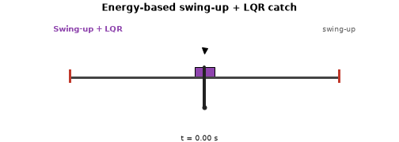
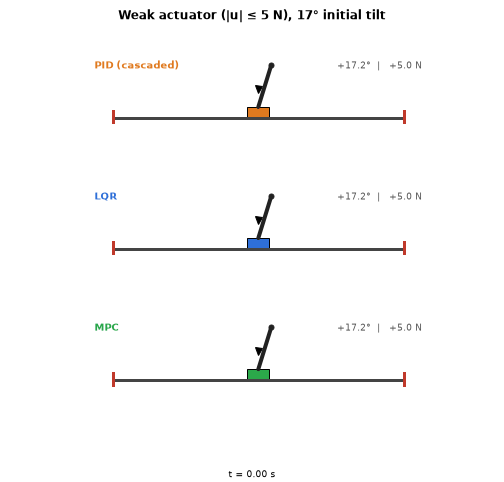
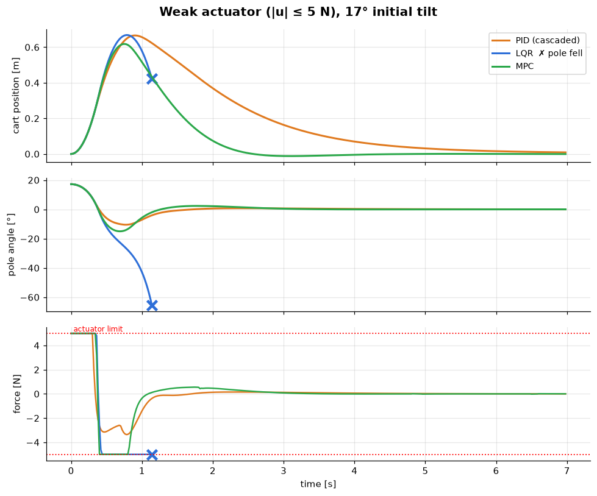
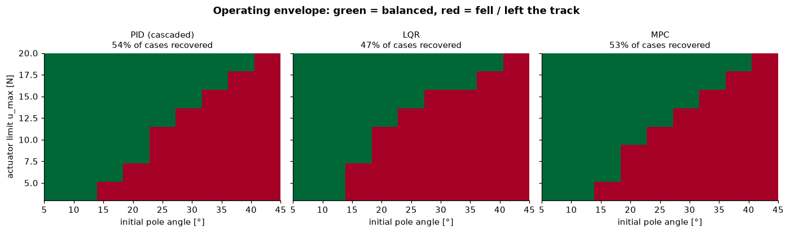
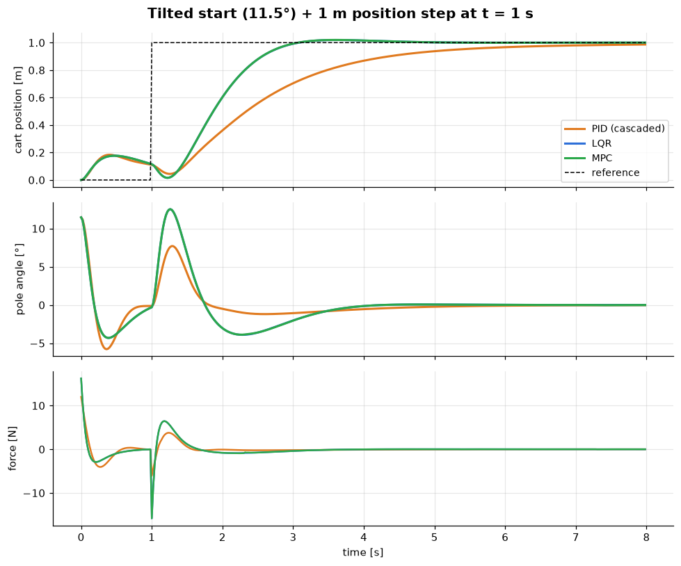
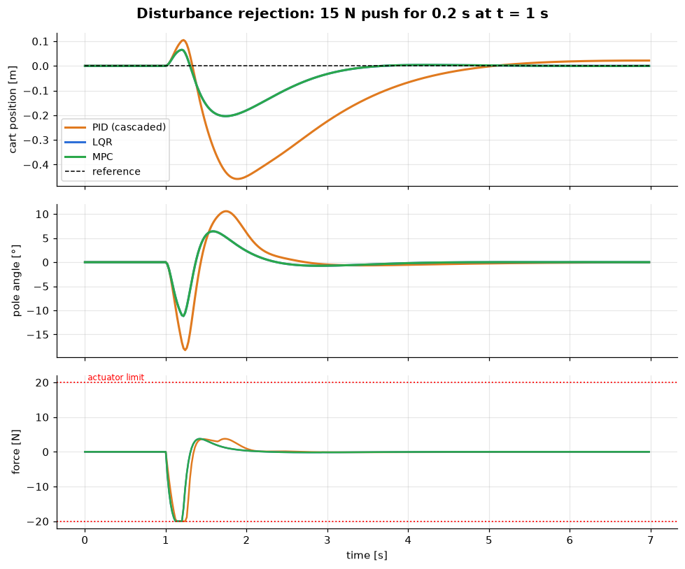
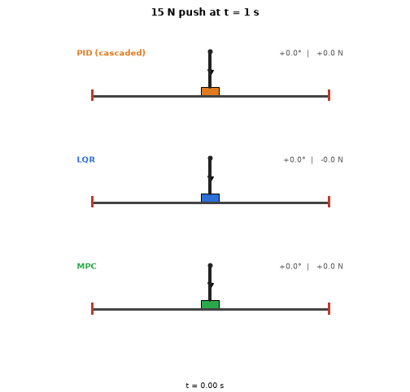
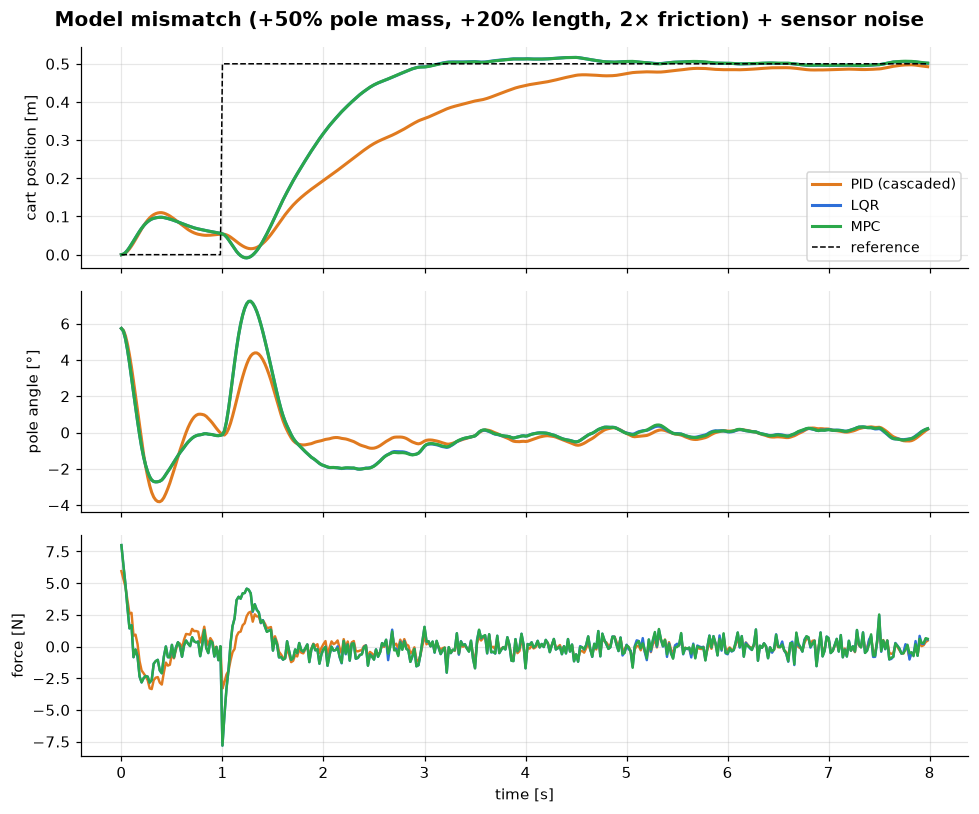
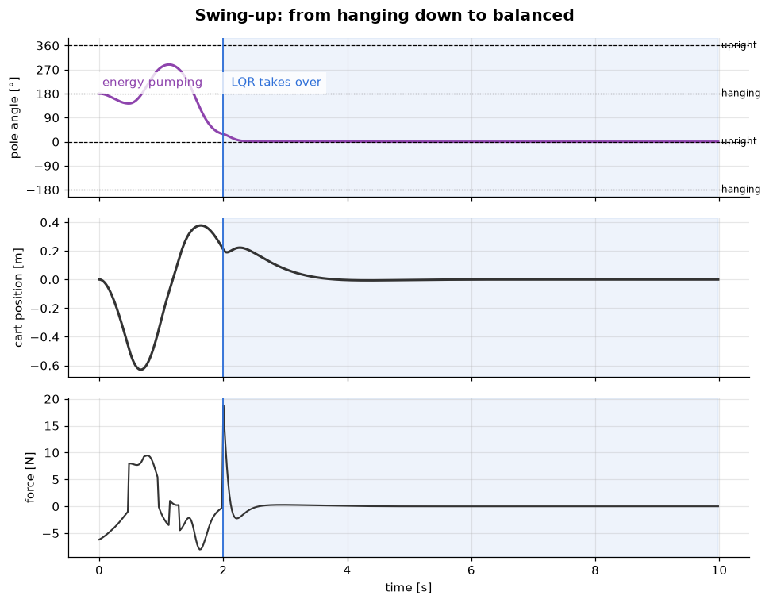

# 🎯 Inverted Pendulum Control: PID vs LQR vs MPC

> Balancing a **nonlinear inverted pendulum on a cart** with three generations of control theory (**classical PID**, **optimal LQR** and **constrained Model Predictive Control**), compared in realistic conditions: actuator limits, disturbances, model errors and sensor noise. Bonus: an **energy-based swing-up** that lifts the pendulum from hanging down and hands it over to LQR.


<p align="center">
  
  <br><em>From hanging down to balanced: energy pumping, then LQR takes over</em>
</p>

---

## ✨ Highlights

- 🧮 **Nonlinear model from first principles** (Lagrangian mechanics), simulated with RK4 at 1 kHz under a 50 Hz digital controller (zero-order hold)
- 🎛️ **Three controllers on equal terms:** cascaded PID with anti-windup, discrete LQR (Riccati), and MPC with hard limits on force and track position solved as a QP every 20 ms
- 🌪️ **Five stress tests:** tilted start + position step, a 15 N push, a 4× weaker motor, model mismatch with sensor noise, and swing-up
- 🗺️ **Operating envelope:** 216 simulations mapping which initial tilts each controller recovers for each motor strength
- 🧪 **32 unit tests** in CI: physics checks (energy conservation, linearization vs finite differences), stability, constraint satisfaction and regression tests for the key results

## 🏁 Results at a glance

| Scenario | PID (cascaded) | LQR | MPC |
|---|---|---|---|
| Tilted start + 1 m step: settling time | 4.34 s | **2.32 s** | **2.32 s** |
| 15 N push: settling time / max tilt | 3.18 s / 18.3° | **1.84 s / 11.2°** | **1.84 s / 11.2°** |
| Weak motor (5 N), 17° tilt | ✅ 4.40 s | ❌ **falls** | ✅ **2.56 s** |
| Model mismatch + sensor noise | ✅ 3.16 s | ✅ **1.94 s** | ✅ **1.94 s** |
| Operating envelope (cases recovered) | **54%** | 47% | 53% |
| Compute time per step | 0.01 ms | **0.005 ms** | ~10 ms |

**Swing-up + LQR:** from hanging straight down to caught in **2.0 s** and fully settled in **3.2 s**, with the cart never more than **0.63 m** from the centre. It succeeds from all 15 tested starting states.

### What the experiments show

1. **When no limit is hit, MPC behaves exactly like LQR.** This is by design: same weights, and the LQR Riccati matrix as terminal cost. Both settle about **2× faster than PID** and tilt the pole less after a push.
2. **LQR breaks when the actuator saturates.** With a 5 N motor, LQR asks for far more force than is available, sits at the limit 93% of the time and loses the pole. **MPC knows the limit and plans around it**, recovering in 2.56 s.
3. **The surprise: PID has the largest operating envelope.** Its gentler gains saturate less, so it survives more combinations of large tilts and weak motors (54%), although it is about 2× slower. MPC recovers most of what LQR loses (53% vs 47%) **without giving up LQR's speed**. This is the classic trade-off between performance and robustness.
4. **All three survive a 50% heavier, 20% longer pole with noisy sensors.** The design margins of linear control are large.
5. **The price of MPC is computation.** About 10 ms per step for a 30-step horizon in Python, but up to ~34 ms with noisy measurements, which is above the 20 ms sample time. A real-time version would need a code-generated solver (acados, OSQP codegen) or a shorter horizon.

<p align="center">
  
  <br><em>Weak actuator (|u| ≤ 5 N): LQR saturates and loses the pole; MPC plans within the limit</em>
</p>

<p align="center">
  
  
</p>

<details>
<summary><b>📈 All figures and full metric tables</b></summary>

<p align="center"></p>
<p align="center"></p>
<p align="center"></p>
<p align="center"></p>
<p align="center"></p>

The full tables (settling time, max angle, overshoot, max force, % saturated, control energy, compute time) are in [`results/metrics.md`](results/metrics.md). They are generated by `experiments/run_all.py`.

</details>

## 🧮 The model

State **x = [p, ṗ, θ, θ̇]** (cart position, cart velocity, pole angle from upright, angular velocity). Input **u** = force on the cart.

The pole is a uniform rod (mass *m*, half-length *l*, inertia about the pivot *J = 4/3·m l²*). From the Lagrangian *L = T − V*:

```
(M + m)·p̈ + m·l·cos θ·θ̈ − m·l·sin θ·θ̇² = u − b·ṗ
m·l·cos θ·p̈ + J·θ̈ − m·g·l·sin θ         = −d·θ̇
```

| Parameter | Value | | Parameter | Value |
|---|---|---|---|---|
| Cart mass *M* | 1.0 kg | | Cart friction *b* | 0.1 N·s/m |
| Pole mass *m* | 0.2 kg | | Pivot friction *d* | 0.002 N·m·s |
| Half-length *l* | 0.3 m | | Actuator limit | ±20 N |
| Control rate | 50 Hz | | Track | ±2 m |

Linearizing around upright gives an **unstable** system (one pole in the right half-plane) that is **fully controllable**. Both facts are checked in the tests.

## 🎛️ The controllers

| | **Cascaded PID** | **LQR** | **MPC** |
|---|---|---|---|
| Idea | Outer PD: position error → desired tilt. Inner PID: tilt error → force | Optimal state feedback *u = −K x* from the discrete Riccati equation | Solve a QP over a 0.6 s horizon every step, apply the first input |
| Needs a model? | No | Linear model | Linear model |
| Handles limits? | Only anti-windup | ❌ (just gets clipped) | ✅ hard limits on force and track |
| Compute per step | ~0.01 ms | ~0.005 ms | ~10 ms (OSQP, 30-step horizon) |

**PID** uses the physics of balancing: to move right, the pole must first lean right, because a cart holding a tilted pole accelerates at *p̈ ≈ g·θ*. The derivative acts on the measurement (no derivative kick), and conditional integration prevents windup.

**LQR**: Q = diag(20, 1, 100, 1), R = 0.05, which gives K = [−15.8, −15.5, −81.1, −14.7]. All closed-loop poles lie inside the unit circle.

**MPC** uses the LQR Riccati matrix as terminal cost, so it **is** LQR when no limit is active, and plans around the limits when they are. The QP is written in error coordinates so it is DPP: CVXPY compiles it once, and every step only updates parameters and warm-starts OSQP.

**Swing-up (Åström–Furuta):** the pole energy *E = ½Jθ̇² + mgl(cos θ − 1)* changes at *dE/dt = −m l p̈ θ̇ cos θ*, so commanding *p̈ = k·E·sign(θ̇ cos θ)* always pushes *E* towards 0 (the upright energy). The commanded acceleration is turned into a force with the model's inverse dynamics. A hybrid automaton with hysteresis switches to LQR near the top, and back if the pole falls.

## 📁 Project structure

```
inverted-pendulum-control/
├── pendulum/
│   ├── model.py            # nonlinear dynamics, RK4, linearization, ZOH discretization, energy
│   ├── simulate.py         # closed loop: saturation, noise, disturbances, model mismatch
│   ├── metrics.py          # settling time, overshoot, control energy, saturation, compute time
│   ├── viz.py              # plots, operating-envelope map, GIF animations
│   └── controllers/
│       ├── pid.py          # cascaded PID + anti-windup
│       ├── lqr.py          # discrete LQR (DARE)
│       ├── mpc.py          # constrained linear MPC (CVXPY + OSQP)
│       └── swingup.py      # energy-based swing-up + LQR hand-over
├── experiments/run_all.py  # reproduces every figure, GIF and table
├── tests/                  # 32 tests (physics + control)
├── assets/                 # generated figures and animations
└── results/metrics.md      # generated tables
```

## ▶️ Run it

```bash
pip install -r requirements.txt

python -m experiments.run_all          # all experiments, figures and GIFs (a few minutes)
python -m experiments.run_all --quick  # tables and static plots only (~30 s)
pytest                                  # run the tests
```

Use a controller in your own code:

```python
import numpy as np
from pendulum.model import CartPoleParams
from pendulum.controllers import MPC
from pendulum.simulate import simulate, push

params = CartPoleParams(u_max=10.0)
result = simulate(MPC(0.02, params), params, x0=np.array([0, 0, 0.2, 0]), duration=5.0,
                  disturbance=push(t_start=2.0, duration=0.1, force=10.0))
print(result.failed, result.x[-1])
```

## 🔮 Ideas for extensions

- [ ] Nonlinear MPC (CasADi) to widen the region of attraction
- [ ] Kalman filter / state observer when only *p* and *θ* are measured
- [ ] Double inverted pendulum
- [ ] Hardware: run the controllers on an Arduino / ESP32 rig

---

<sub>Built by Goga Alex-Andrei · Systems & Control engineering · MIT License</sub>
